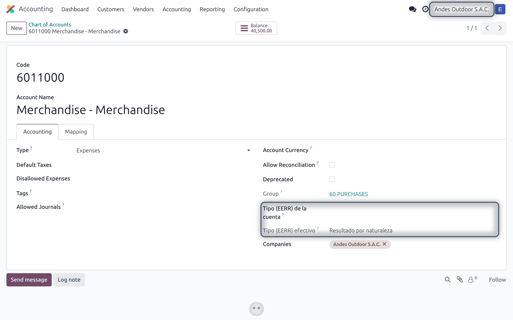
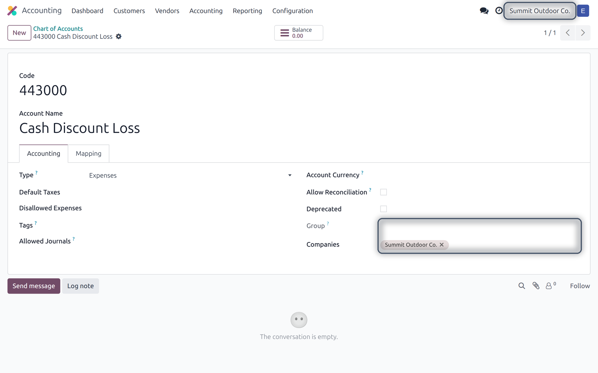

## Overview

Localization modules add fields that only make sense for one country, such as the Peruvian classification of the accounts for the trial balance. In a database with companies in several countries, showing those fields to every company only clutters the screens.

This technical module adapts the screens to the country of the company the user is working in. The modules built on it declare which fields belong to which countries, and the forms, lists and kanban cards of other countries do not show them. It does nothing on its own: it is installed with the modules that use it.

### What you get

| Feature | What it does |
|---|---|
| Forms and kanban | The fields of another country are hidden. |
| Lists | Their columns are removed. |
| Company switcher | Changing the active company shows the screens of the new company's country. |
| Nothing to set up | The modules that use it declare their fields; there is no configuration. |

## Requirements and installation

| | |
|---|---|
| Odoo version | 18.0 |
| Edition | Community and Enterprise (on premise or Odoo.sh) |
| Required apps | None |
| Languages | English, Spanish |

It is installed automatically with the modules that depend on it, such as the Peruvian trial balance. It can also be installed alone from <span class="menu">Apps</span>, but it changes nothing until a module uses it.

## How it looks

The example database has a Peruvian company and a US one, and the Peruvian trial balance installed. In the Peruvian company, the account form shows the two Peruvian fields of the module:



After switching to the US company in the top right, the form of an account of that company does not show them:



## For developers

A module declares its fields in `_get_view` of the model:

```
@api.model
def _get_view(self, view_id=None, view_type='form', **options):
    arch, view = super()._get_view(view_id, view_type, **options)
    tags = [('field', 'l10n_pe_type_group')]
    countries = [self.env.ref('base.pe')]
    return self._tags_invisible_per_country(arch, view, view_type, tags, countries)
```

`tags` takes `(tag, name)` pairs, so groups and pages with a `name` work too. The views are cached per company, so each company gets its own.

## Support

For questions or help with the module, write to **{{support}}**. Please include your Odoo version and edition, and a screenshot if you can. Customizations on request.
