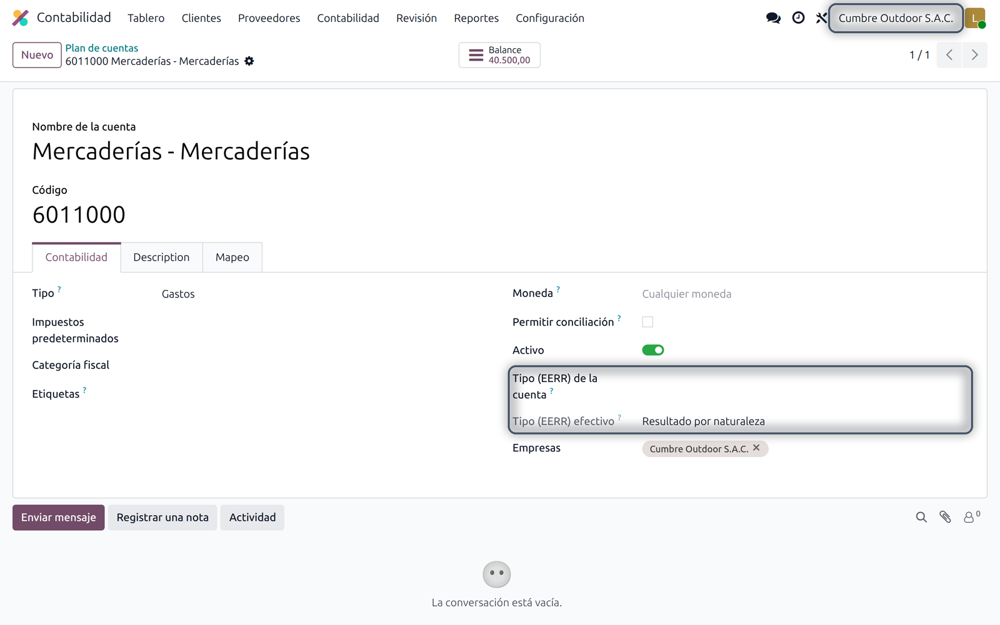
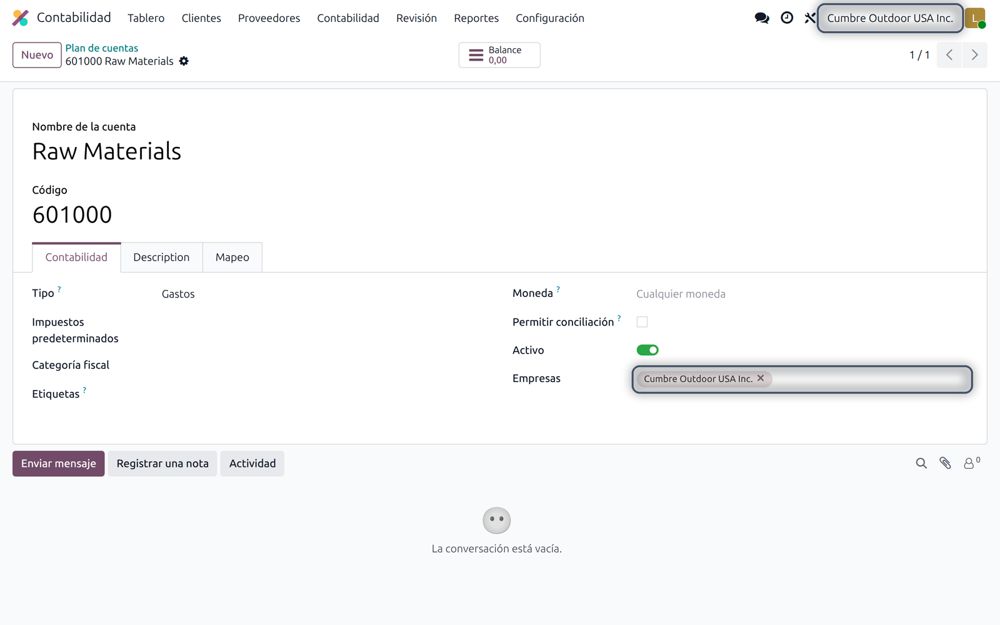

## Introducción

Los módulos de localización agregan campos que solo tienen sentido para un país, como la clasificación peruana de las cuentas para el balance de comprobación. En una base de datos con compañías de varios países, mostrar esos campos a todas solo recarga las pantallas.

Este módulo técnico adapta las pantallas al país de la compañía con la que trabaja el usuario. Los módulos que se apoyan en él declaran qué campos son de qué países, y los formularios, listas y tarjetas kanban de otros países no los muestran. Por sí solo no hace nada: se instala con los módulos que lo usan.

### Qué incluye

| Función | Qué hace |
|---|---|
| Formularios y kanban | Los campos de otro país se ocultan. |
| Listas | Sus columnas se quitan. |
| Selector de compañía | Al cambiar de compañía se ven las pantallas del país de la nueva. |
| Nada que configurar | Los módulos que lo usan declaran sus campos; no hay configuración. |

## Requisitos e instalación

| | |
|---|---|
| Versión de Odoo | 19.0 |
| Edición | Community y Enterprise (instalación propia u Odoo.sh) |
| Aplicaciones requeridas | Ninguna |
| Idiomas | Inglés, español |

Se instala automáticamente con los módulos que dependen de él, como el balance de comprobación peruano. También se puede instalar solo desde <span class="menu">Aplicaciones</span>, pero no cambia nada hasta que un módulo lo use.

## Cómo se ve

La base de ejemplo tiene una compañía peruana y otra de Estados Unidos, y el balance de comprobación peruano instalado. En la compañía peruana, la ficha de una cuenta muestra los dos campos peruanos del módulo:



Al cambiar a la compañía de Estados Unidos arriba a la derecha, la ficha de una cuenta de esa compañía no los muestra:



## Para desarrolladores

Un módulo declara sus campos en `_get_view` del modelo:

```
@api.model
def _get_view(self, view_id=None, view_type='form', **options):
    arch, view = super()._get_view(view_id, view_type, **options)
    tags = [('field', 'l10n_pe_type_group')]
    countries = [self.env.ref('base.pe')]
    return self._tags_invisible_per_country(arch, view, view_type, tags, countries)
```

`tags` recibe pares `(etiqueta, nombre)`, así que también sirven grupos y páginas con `name`. Las vistas se guardan en caché por compañía, de modo que cada una recibe la suya.

## Soporte

Para consultas o ayuda con el módulo, escribe a **{{support}}**. Indica tu versión y edición de Odoo y, si puedes, adjunta una captura. Personalizaciones a pedido.
