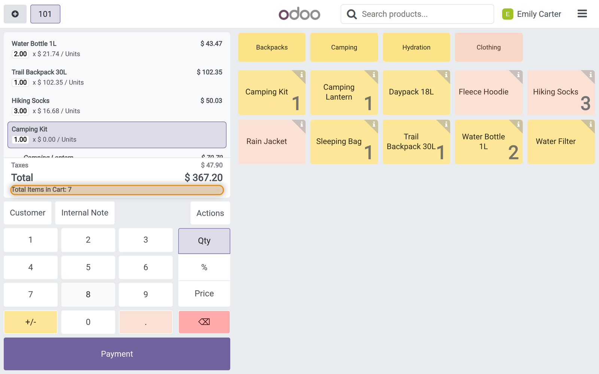
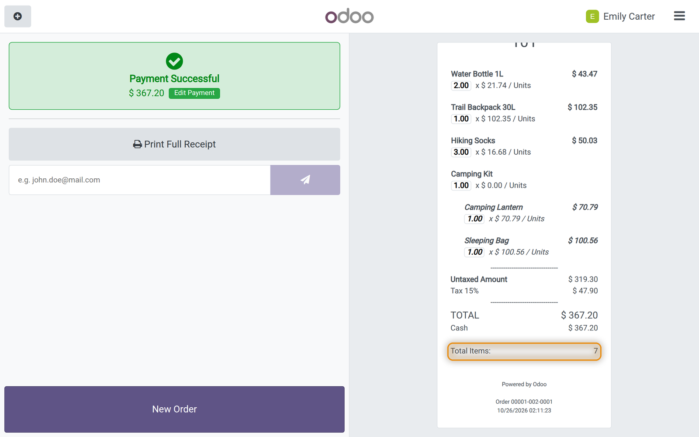

## Overview

When an order has several products, and several units of some of them, the cashier has to add them up to check the bag, and the customer often asks how many items they are paying for. Odoo shows the lines and the amount of the order, not the number of items.

This module shows the number of items on the order of the point of sale and on the printed receipt. There is nothing to set up: once installed, the count is there.

### What you get

| Feature | What it does |
|---|---|
| Items on the order | *Total Items in Cart*, below the total, updated as products are added. |
| Items on the receipt | The same count on the printed receipt, as *Total Items:*. |
| Units, not lines | Quantities are added up: three pairs of socks are three items. |
| Combos | A combo counts as one item, whatever products it holds. |
| Products given back | A line with a negative quantity is not counted. |

### Who it is for

Shops that pack the order at the till, and any business that wants the number of items in front of the cashier and on the receipt.

## Requirements and installation

| | |
|---|---|
| Odoo version | 18.0 |
| Edition | Community and Enterprise (on premise or Odoo.sh) |
| Required apps | Point of Sale |
| Languages | English, Spanish. Other languages on request. |

<ol class="steps">
<li>Copy the module folder into your custom addons path (or add it to your Odoo.sh repository).</li>
<li>Restart the Odoo server.</li>
<li>Go to Apps, click Update Apps List, search for <strong>POS Items Count</strong> and click Activate.</li>
</ol>

There is nothing to configure after the installation.

## At the till

The order shows *Total Items in Cart*, below the total. It changes as soon as a product is added, a quantity is changed or a line is removed.

In the example the order has 2 water bottles, a backpack, 3 pairs of socks and a camping kit, a combo with a lantern and a sleeping bag: 7 items. The kit counts once.

### On the receipt

The printed receipt shows the same count, so the customer can check it too.

!!! note "How the items are counted"
    The quantities of the lines are added up. A combo is one item: the products inside it are not counted again. A line with a negative quantity, a product given back, is not counted, so a refund shows 0 items. A product sold by weight adds its quantity, for example 0.75 for 0.75 kg.

## Frequently asked questions

**Does it count lines or units?**
Units. A line with 3 units adds 3.

**Is there anything to set up?**
No. The count shows on every point of sale of the database as soon as the module is installed.

**Is the count saved with the order?**
No. It is worked out from the lines on the screen and on the receipt; the order keeps its lines and quantities as usual.

**Does it work with Odoo Community?**
Yes. It only needs the Point of Sale app.

## Support

For questions or help with the module, write to **{{support}}**. Please include your Odoo version and edition, and a screenshot if you can. Customizations on request.
