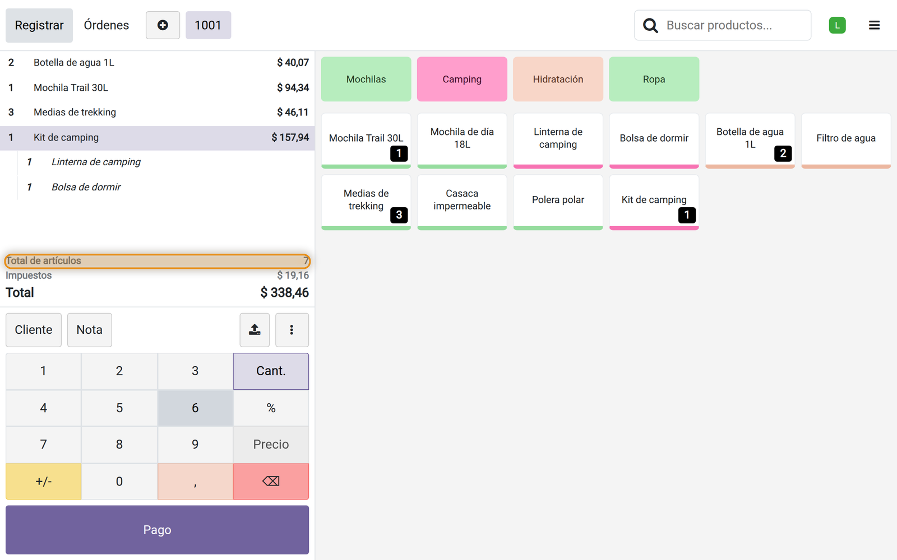
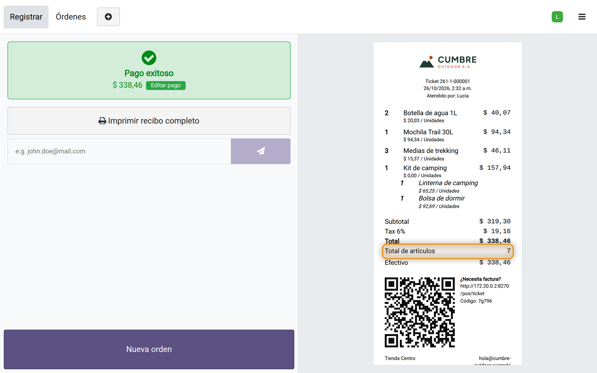

## Introducción

Cuando una orden tiene varios productos, y varias unidades de algunos, el cajero tiene que sumarlos para revisar la bolsa, y el cliente suele preguntar cuántos artículos está pagando. Odoo muestra las líneas y el monto de la orden, pero no la cantidad de artículos.

Este módulo muestra la cantidad de artículos en la orden del punto de venta y en el recibo impreso. No hay nada que configurar: al instalarlo, el total ya aparece.

### Qué incluye

| Función | Qué hace |
|---|---|
| Artículos en la orden | *Total de artículos*, encima de los impuestos, al día con cada producto agregado. |
| Artículos en el recibo | El mismo total en el recibo impreso, como *Total de artículos*, justo debajo del total. |
| Unidades, no líneas | Se suman las cantidades: tres pares de medias son tres artículos. |
| Combos | Un combo cuenta como un artículo, tenga los productos que tenga. |
| Productos devueltos | Una línea con cantidad negativa no se cuenta. |

### Para quién es

Tiendas que empacan la orden en la caja, y cualquier negocio que quiera la cantidad de artículos a la vista del cajero y en el recibo.

## Requisitos e instalación

| | |
|---|---|
| Versión de Odoo | 19.0 |
| Edición | Community y Enterprise (instalación propia u Odoo.sh) |
| Aplicaciones requeridas | Punto de venta |
| Idiomas | Inglés, español. Otros idiomas a pedido. |

<ol class="steps">
<li>Copia la carpeta del módulo en tu ruta de addons personalizados (o agrégala a tu repositorio de Odoo.sh).</li>
<li>Reinicia el servidor de Odoo.</li>
<li>Ve a Aplicaciones, haz clic en Actualizar lista de aplicaciones, busca <strong>POS Items Count</strong> y haz clic en Activar.</li>
</ol>

No hay nada que configurar después de la instalación.

## En la caja

La orden muestra *Total de artículos*, encima de los impuestos. Cambia en cuanto se agrega un producto, se modifica una cantidad o se quita una línea.

En el ejemplo la orden tiene 2 botellas de agua, una mochila, 3 pares de medias y un kit de camping, un combo con una linterna y una bolsa de dormir: 7 artículos. El kit cuenta una sola vez.

### En el recibo

El recibo impreso muestra el mismo total, para que el cliente también pueda revisarlo.

!!! note "Cómo se cuentan los artículos"
    Se suman las cantidades de las líneas. Un combo es un artículo: los productos que lleva dentro no se vuelven a contar. Una línea con cantidad negativa, un producto devuelto, no se cuenta, así que un reembolso muestra 0 artículos. Un producto vendido por peso suma su cantidad, por ejemplo 0,75 por 0,75 kg.

## Preguntas frecuentes

**¿Cuenta líneas o unidades?**
Unidades. Una línea con 3 unidades suma 3.

**¿Hay que configurar algo?**
No. El total aparece en todos los puntos de venta de la base en cuanto se instala el módulo.

**¿El total se guarda con la orden?**
No. Se calcula a partir de las líneas, en la pantalla y en el recibo; la orden guarda sus líneas y cantidades como siempre.

**¿Funciona con Odoo Community?**
Sí. Solo necesita la aplicación Punto de venta.

## Soporte

Para consultas o ayuda con el módulo, escribe a **{{support}}**. Indica tu versión y edición de Odoo y, si puedes, adjunta una captura. Personalizaciones a pedido.
