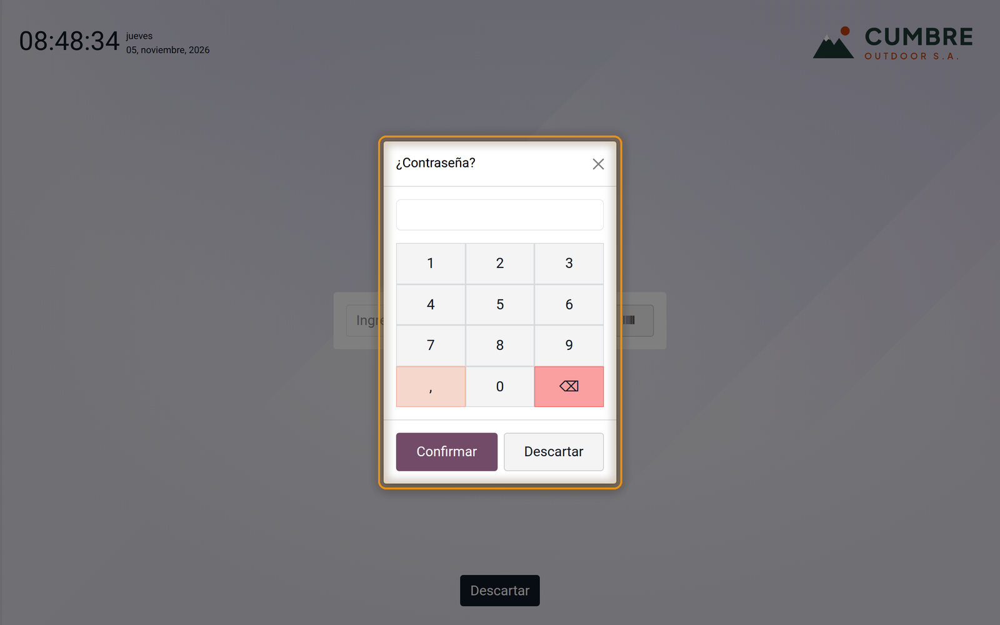
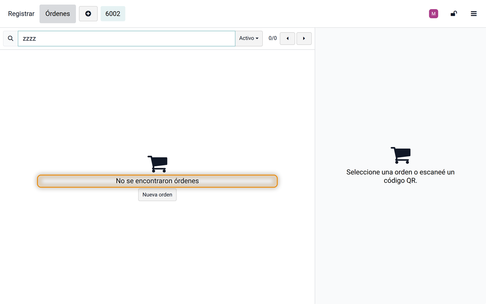
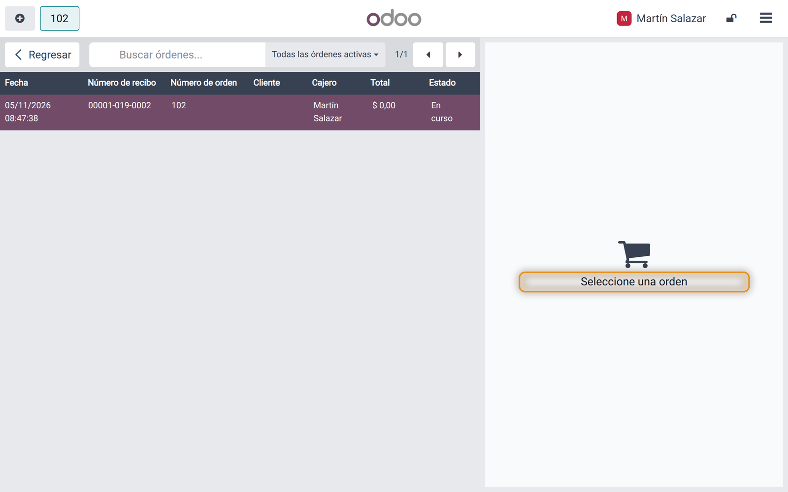
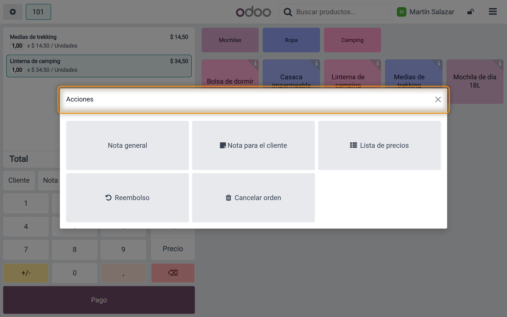
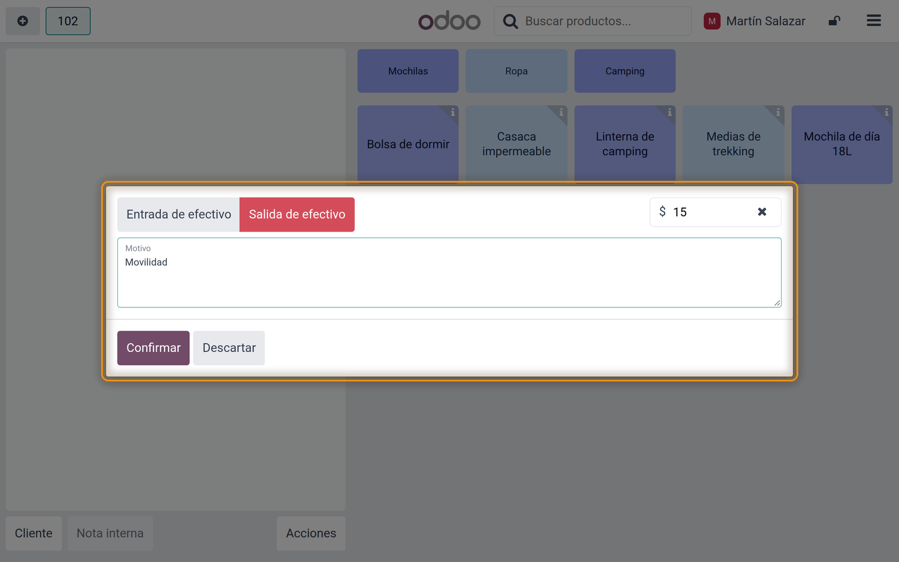
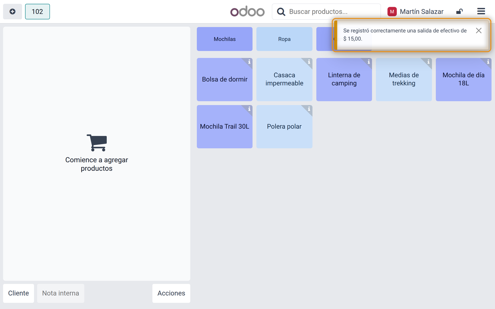
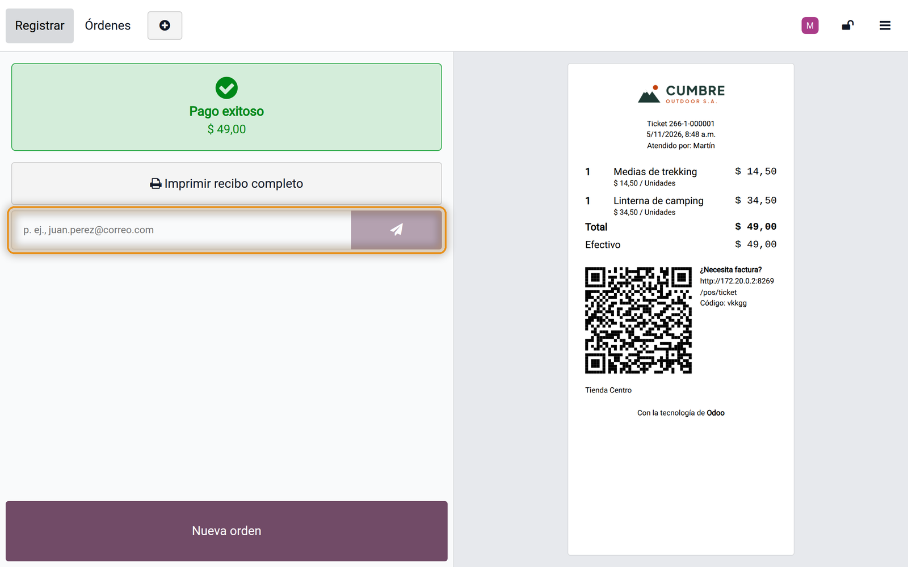

## Overview

Some texts of the point of sale of Odoo 18.0 stay in English whatever the language of the cashier. Odoo writes them inside code where its translations never reach, or leaves them out of its translation files. In a shop that works in Spanish, cashiers see *Ok*, *No orders found* or *out* in the middle of screens that are otherwise in Spanish.

This module makes those texts translatable and ships their Spanish translation. It changes no behaviour of the point of sale and installs by itself with it.

### What it fixes

| Where | Odoo shows | With the module |
|---|---|---|
| Number windows (employee PIN, discount, price, quantity, guests, tip) | Ok, Discard | Confirmar, Descartar |
| List of orders | Loading..., No orders found, Select an order | Cargando..., No se encontraron órdenes, Seleccione una orden |
| Title of the Actions window | Actions | Acciones |
| Lot or serial number of a line | Valid product lot, Invalid product lot | Lote de producto válido, Lote de producto no válido |
| E-mail field of the receipt screen | e.g. john.doe@mail.com | p. ej., juan.perez@correo.com |
| Cash in and out: notification, receipt, session note and label | out, in | Salida de efectivo, Entrada de efectivo |

### Who it is for

Every point of sale that works in Spanish (es, es_419, es_PE), or in another language once its translation is added.

## Requirements and installation

| | |
|---|---|
| Odoo version | 18.0 |
| Edition | Community and Enterprise (on premise or Odoo.sh) |
| Required apps | Point of Sale |
| Languages | Spanish (es, es_419, es_PE). Other languages on request. |
| Price | Free |

<ol class="steps">
<li>Copy the module folder into your custom addons path (or add it to your Odoo.sh repository).</li>
<li>Restart the Odoo server.</li>
<li>Go to Apps, click Update Apps List, search for <strong>POS Translation Fix</strong> and click Activate. In a new database it installs by itself with the Point of Sale.</li>
<li>Reload the point of sale in the browser of each till.</li>
</ol>

There is nothing to set up.

## What the cashier sees

The screenshots come from a point of sale in Spanish.

## Frequently asked questions

**Does it change how the point of sale works?**
No. It only makes texts translatable; buttons, prices and receipts work as before.

**I installed it and still see English.**
Reload the point of sale in the browser (the till keeps its files in cache), and check that the language of the user or employee is Spanish.

**Can you add my language?**
Yes. The texts are now translatable like any other: we can add the translation of your language on request.

**Does it work with Odoo Community?**
Yes. It only needs the Point of Sale app.

## Support

For questions or help with the module, write to **{{support}}**. Please include your Odoo version and edition, and a screenshot if you can.
