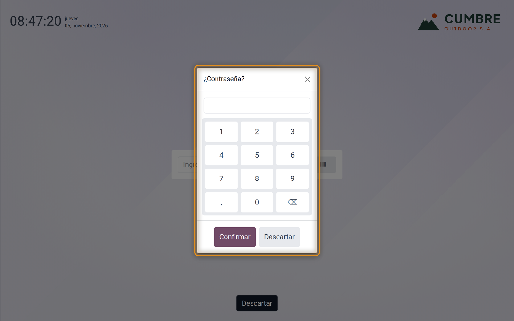
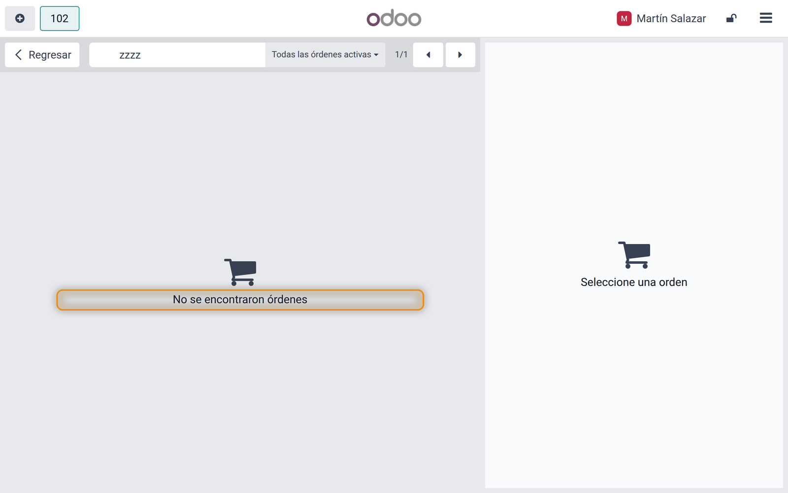
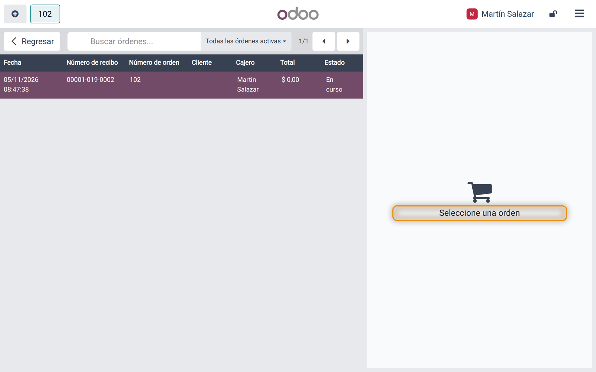
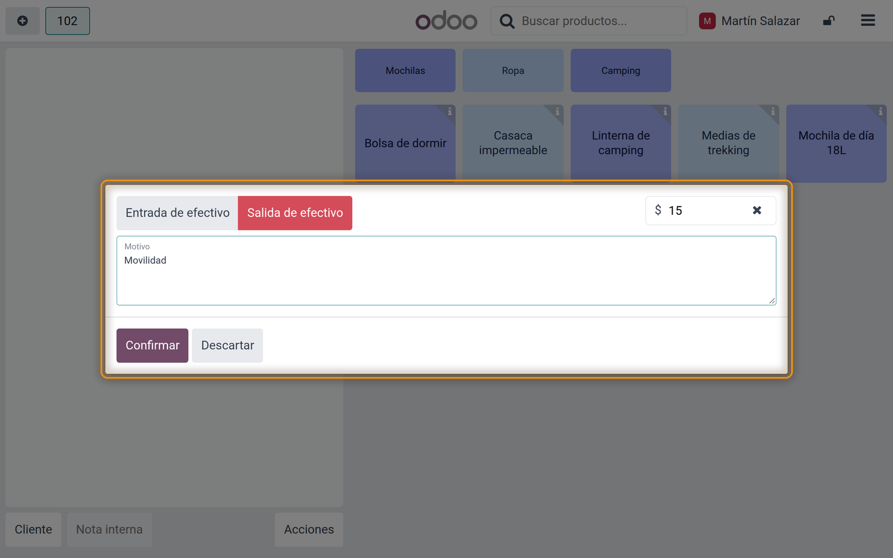
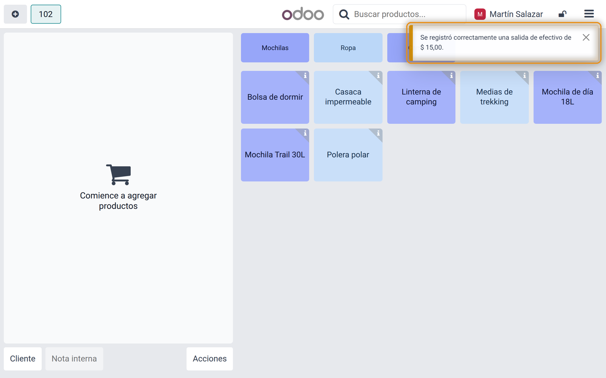
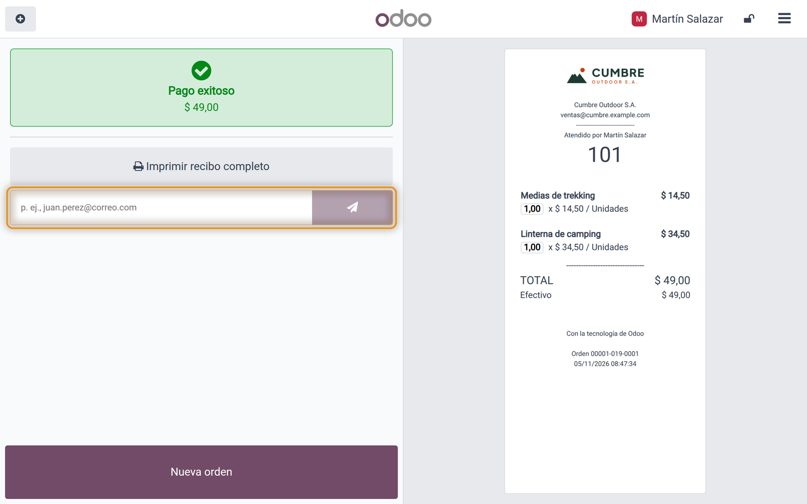

## Introducción

Algunos textos del punto de venta de Odoo 18.0 se quedan en inglés, sea cual sea el idioma del cajero. Odoo los escribe dentro del código, donde sus traducciones nunca llegan, o los deja fuera de sus archivos de traducción. En una tienda que trabaja en español, los cajeros ven *Ok*, *No orders found* u *out* en medio de pantallas que están en español.

Este módulo hace que esos textos se puedan traducir y trae su traducción al español. No cambia el funcionamiento del punto de venta y se instala solo junto con él.

### Qué corrige

| Dónde | Odoo muestra | Con el módulo |
|---|---|---|
| Ventanas numéricas (PIN del empleado, descuento, precio, cantidad, comensales, propina) | Ok, Discard | Confirmar, Descartar |
| Lista de órdenes | Loading..., No orders found, Select an order | Cargando..., No se encontraron órdenes, Seleccione una orden |
| Lote o número de serie de una línea | Valid product lot, Invalid product lot | Lote de producto válido, Lote de producto no válido |
| Campo de correo de la pantalla del ticket | e.g. john.doe@mail.com | p. ej., juan.perez@correo.com |
| Entrada y salida de efectivo: aviso, ticket, nota de la sesión y etiqueta | out, in | Salida de efectivo, Entrada de efectivo |

### Para quién es

Todo punto de venta que trabaje en español (es, es_419, es_PE), o en otro idioma una vez agregada su traducción.

## Requisitos e instalación

| | |
|---|---|
| Versión de Odoo | 18.0 |
| Edición | Community y Enterprise (on premise u Odoo.sh) |
| Aplicaciones necesarias | Punto de Venta |
| Idiomas | Español (es, es_419, es_PE). Otros idiomas a pedido. |
| Precio | Gratis |

<ol class="steps">
<li>Copie la carpeta del módulo en su ruta de addons personalizados (o agréguela a su repositorio de Odoo.sh).</li>
<li>Reinicie el servidor de Odoo.</li>
<li>Vaya a Aplicaciones, haga clic en Actualizar lista de aplicaciones, busque <strong>POS Translation Fix</strong> y haga clic en Activar. En una base nueva se instala solo con el Punto de Venta.</li>
<li>Recargue el punto de venta en el navegador de cada caja.</li>
</ol>

No hay nada que configurar.

## Lo que ve el cajero

## Preguntas frecuentes

**¿Cambia el funcionamiento del punto de venta?**
No. Solo hace que los textos se puedan traducir; botones, precios y tickets funcionan como antes.

**Lo instalé y sigo viendo inglés.**
Recargue el punto de venta en el navegador (la caja guarda sus archivos en caché) y revise que el idioma del usuario o del empleado sea español.

**¿Pueden agregar mi idioma?**
Sí. Los textos ahora se traducen como cualquier otro: podemos agregar la traducción de su idioma a pedido.

**¿Funciona con Odoo Community?**
Sí. Solo necesita la aplicación Punto de Venta.

## Soporte

Para consultas o ayuda con el módulo, escriba a **{{support}}**. Incluya su versión y edición de Odoo, y una captura de pantalla si puede.
